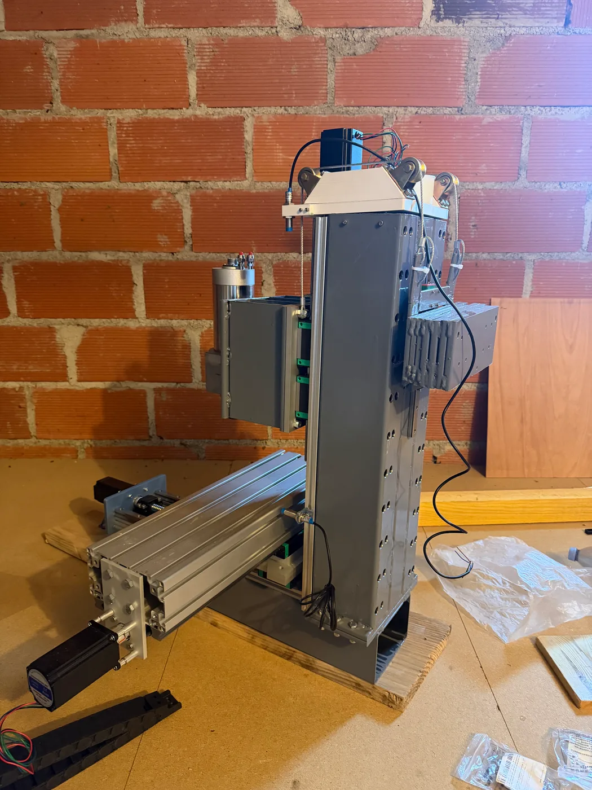
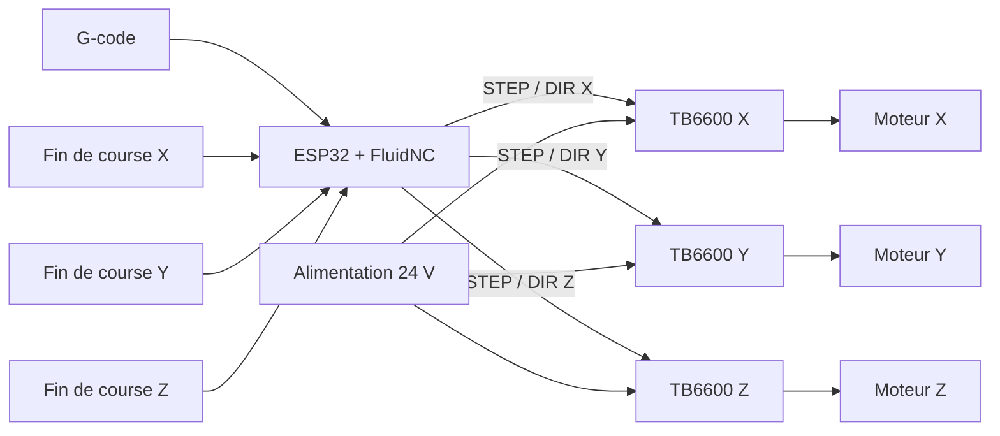
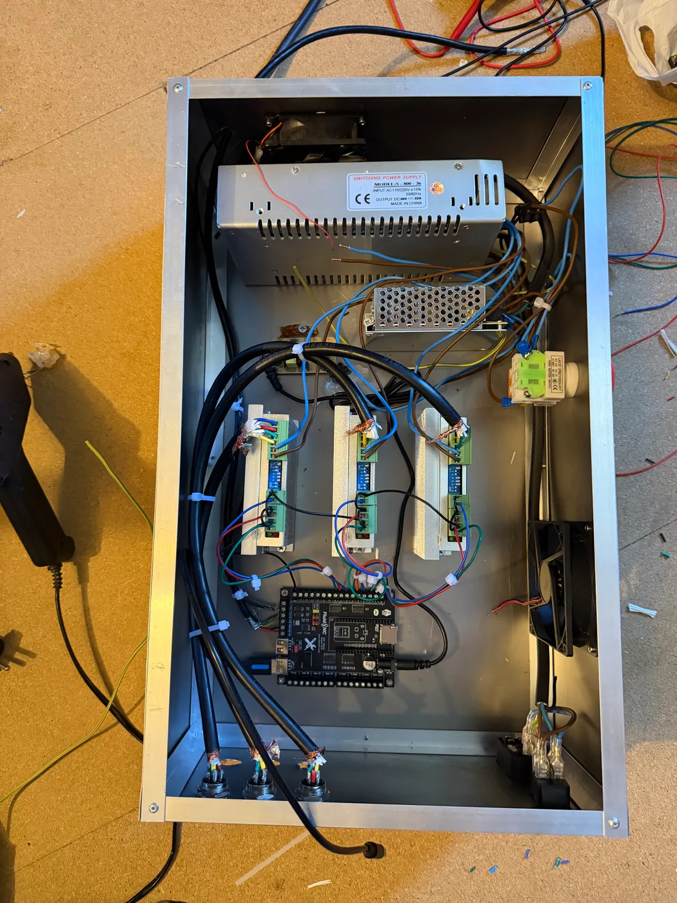

# Fraiseuse CNC 3 axes

Construction d’une fraiseuse numérique avec mon frère, depuis la fabrication du châssis mécano-soudé jusqu’à l’intégration du coffret de commande. Ce dépôt documente le cheminement du projet, les choix retenus et les contrôles nécessaires avant les premiers usinages.

## Objectif du projet

L’objectif est d’obtenir une machine trois axes suffisamment rigide et réglable pour apprendre l’usinage numérique et fabriquer des pièces de projet. La construction a été divisée en sous-ensembles afin de pouvoir vérifier séparément la structure, les mouvements, la commande et la puissance.

## 1. Architecture de commande

La carte 32 bits équipée d’un ESP32 exécute FluidNC. Elle interprète le G-code et produit, pour chaque axe, deux signaux principaux :

- `STEP` : une impulsion correspond à un incrément de mouvement ;
- `DIR` : le niveau logique fixe le sens du déplacement.

Ces signaux ne fournissent pas directement la puissance aux moteurs. Trois drivers TB6600 reçoivent la commande de la carte et régulent le courant dans les deux bobines des moteurs NEMA 23.

La puissance de la broche reste sur une chaîne séparée et est commutée par un relais externe. L’électronique de commande reçoit une alimentation 5 V distincte.

## 2. Composants intégrés

| Élément | Quantité | Fonction | Contrôle avant mise sous tension |
|---|---:|---|---|
| Carte CNC 32 bits V3.0 | 1 | Distribution des entrées/sorties de commande | Orientation des modules et absence de court-circuit |
| ESP32 WROOM, 38 broches | 1 | Exécution de FluidNC et communication | Firmware, fichier YAML et tension 5 V |
| Drivers TB6600 | 3 | Pilotage en courant des moteurs | Courant, micro-pas, ventilation et polarité |
| Moteurs NEMA 23, arbre 6,35 mm | 3 | Entraînement des axes X, Y et Z | Identification des deux bobines et liberté mécanique |
| Alimentation 24 V, 15 A minimum | 1 | Puissance des trois axes | Tension à vide, terre et protection en amont |
| Alimentation 5 V, 3 A minimum | 1 | Alimentation de la logique | Mesure de la tension avant raccordement |
| Fins de course | 3 | Référencement des axes | Test manuel de chaque entrée |
| Câble blindé pour capteurs | selon implantation | Réduction des perturbations sur les entrées | Continuité du blindage et cheminement séparé |
| Arrêt d’urgence et reset | 1 de chaque | Coupure et reprise après défaut | Action réelle sur la chaîne d’énergie |
| Relais externe de broche | 1 | Marche/arrêt de la broche | Isolement commande/puissance |

## 3. Câblage des moteurs et fins de course

### Identifier les bobines

Chaque moteur bipolaire possède deux bobines. Les deux paires de conducteurs sont repérées au multimètre, puis raccordées aux sorties `A+ / A−` et `B+ / B−` du driver. Une erreur de paire empêche le moteur de fonctionner correctement.

### Relier les drivers

Le câblage est réalisé axe par axe :

1. sortie `STEP` de la carte vers l’entrée impulsion du driver ;
2. sortie `DIR` vers l’entrée de direction ;
3. éventuelle ligne `ENABLE` si elle est utilisée dans la configuration ;
4. alimentation 24 V distribuée en parallèle aux trois drivers ;
5. quatre conducteurs moteur entre chaque driver et son NEMA 23.

Si un axe se déplace dans le sens opposé à celui attendu, le sens peut être inversé dans la configuration ou en inversant de manière cohérente une paire de bobine. Si le moteur ne réagit qu’à une direction, la liaison `DIR` doit être contrôlée en priorité.

### Raccorder les fins de course

Les trois capteurs de référence rejoignent les entrées X, Y et Z déclarées dans le YAML. Leur câblage est éloigné autant que possible des conducteurs moteurs et de la broche. L’utilisation d’un câble blindé limite les déclenchements parasites.

Avant toute procédure automatique, chaque contact est pressé à la main : le statut doit passer de `Idle` à `Alarm`. Après reset et déverrouillage, le test est répété sur les trois axes.

## Configuration de FluidNC

FluidNC et la configuration de la machine sont stockés dans l’ESP32. Les paramètres propres à la CNC sont regroupés dans un fichier YAML :

- affectation des broches STEP, DIR et fins de course ;
- nombre de pas par millimètre ;
- vitesse et accélération maximales ;
- course utile de chaque axe ;
- sens positif/négatif ;
- séquence de référencement ;
- commande du relais de broche.

Les modifications destinées à être conservées sont reportées dans le fichier YAML, puis la carte est redémarrée pour charger la nouvelle configuration.

## Mise en service

La validation suit un ordre volontairement progressif :

1. **Mesures électriques** — vérifier les tensions, la continuité de terre et l’absence de court-circuit avant de raccorder les cartes.
2. **Communication** — confirmer que FluidNC répond et que l’état est `Idle`.
3. **Déplacements courts** — tester chaque axe séparément, sans outil monté et avec une faible distance commandée.
4. **Sens** — X− doit aller vers la gauche, Y− vers l’opérateur et Z− doit abaisser la broche.
5. **Fins de course** — provoquer chaque entrée manuellement avant de lancer `Home`.
6. **Référencement** — vérifier que Z remonte avant le référencement de X et Y.
7. **Pas par millimètre** — commander une distance connue, la mesurer et corriger la valeur dans le YAML.
8. **Géométrie** — contrôler l’équerrage, les jeux, la répétabilité et la liberté de mouvement.
9. **Premier usinage** — commencer avec une pièce tendre et des paramètres prudents, puis documenter le résultat.

## État actuel

- structure et guidages assemblés ;
- broche installée ;
- trois axes motorisés ;
- coffret et chaîne de puissance en cours de finalisation ;
- repérage définitif, mesures de répétabilité et premier usinage encore à documenter.

Le dossier visuel complet est disponible sur [la page CNC du portfolio](https://paul-n7-3ea-eportfolio.vercel.app/cnc.html).

## Documentation consultée

- [Carte CNC 32 bits V3.0 — sommaire](https://www.makerfr.com/cnc/menu-cnc-32bits-board-v3-0/)
- [Liste des composants](https://www.makerfr.com/cnc/menu-cnc-32bits-board-v3-0/listes-des-pieces-cnc-32bits-board-v3-0/)
- [Installation et configuration de FluidNC](https://www.makerfr.com/en/cnc/menu-cnc-32bits-board-v3-0/installer-et-configurer-fluidnc/)
- [Liste des pièces RS-CNC32](https://www.makerfr.com/en/cnc/rs-cnc32/liste-des-pieces-rs-cnc32/)

> La documentation ci-dessus sert de référence d’architecture. Le câblage final, les protections et les réglages doivent correspondre aux composants réellement montés sur la machine.
